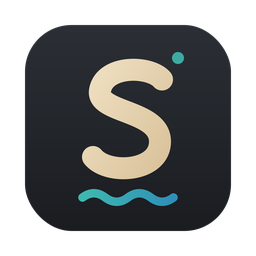
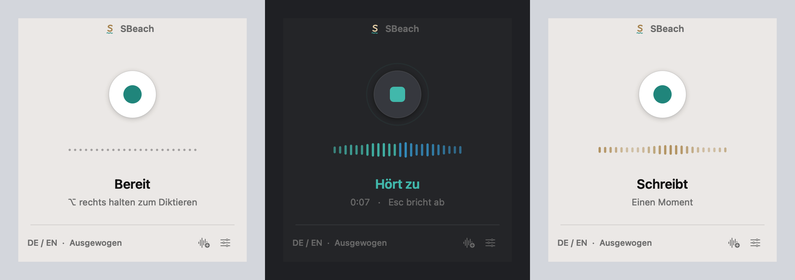
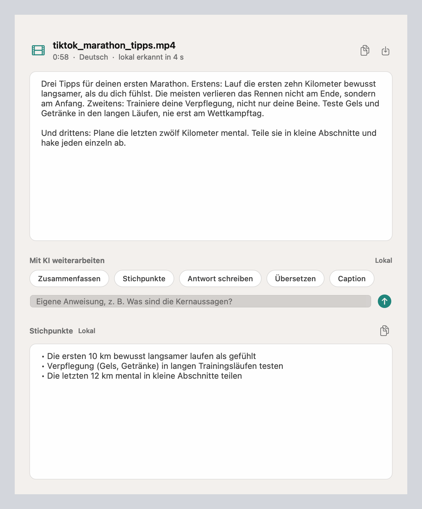
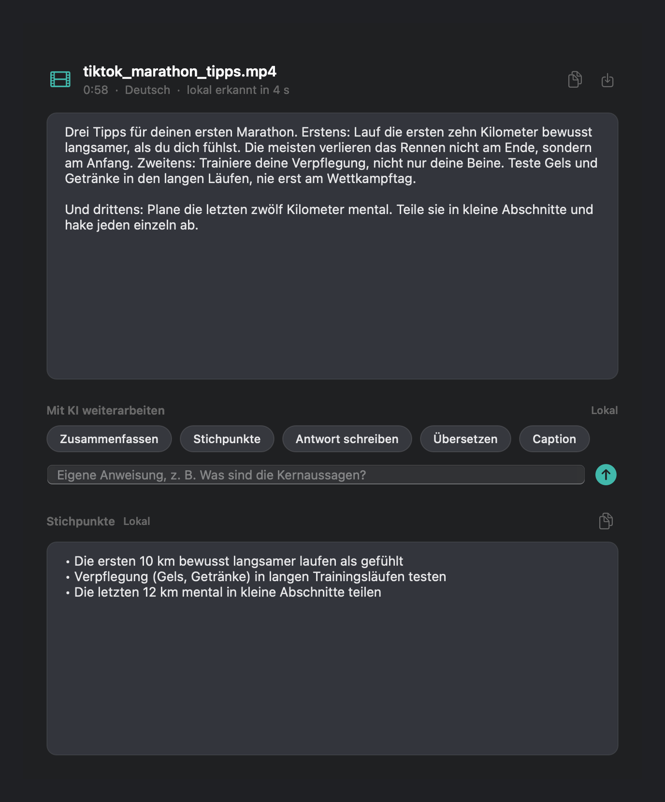
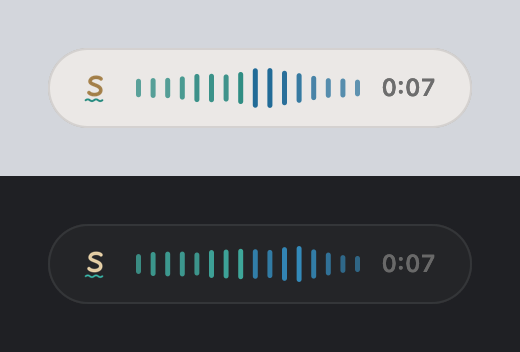
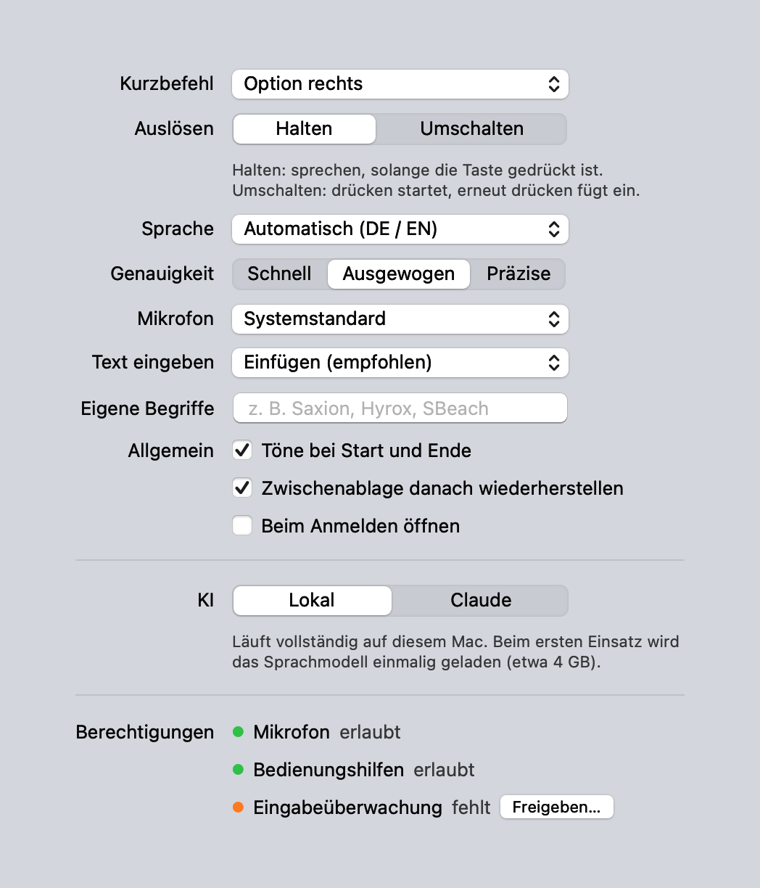

<p align="center">
  
</p>

<h1 align="center">SBeach</h1>

<p align="center">
  <b>Speech + Beach.</b> Lokales Diktieren für macOS.<br>
  Taste halten, sprechen, loslassen, und der Text steht dort, wo dein Cursor ist. In jeder App, ohne Cloud.
</p>

<p align="center">
  
</p>

---

## Was SBeach kann

**Diktieren in jede App.** Ein globaler Kurzbefehl startet die Aufnahme, die Spracherkennung läuft vollständig lokal mit Whisper auf dem Mac, und der Text wird direkt in die aktive App eingefügt: Mail, Notizen, WhatsApp, Browser, IDE.

**Audio und Video transkribieren.** TikToks, Sprachnachrichten, Podcasts oder Meetings einfach auf das Fenster ziehen. Lange Dateien werden in Abschnitten mit sichtbarem Fortschritt verarbeitet. Export als Text oder als Untertitel (SRT), etwa für CapCut oder Premiere.

**Mit KI weiterarbeiten.** Transkripte per Klick zusammenfassen, in Stichpunkte fassen, beantworten, übersetzen oder als Social Media Caption umschreiben. Oder eine eigene Anweisung eingeben. Die KI läuft wahlweise lokal (Qwen 2.5 7B über MLX) oder über Claude.

**Privat by Design.** Audio verlässt den Mac nie. Bei der optionalen Claude Integration wird ausschließlich Text übertragen, der API Schlüssel liegt im macOS Schlüsselbund.

<p align="center">
  
  
</p>

## Bedienung

| Aktion | So geht's |
|---|---|
| Diktieren | Kurzbefehl halten (Standard: Option rechts), sprechen, loslassen |
| Umschalten statt Halten | In den Einstellungen wählbar: einmal drücken startet, nochmal drücken fügt ein |
| Abbrechen | Esc |
| Datei transkribieren | Datei aufs Fenster ziehen, ＋ Symbol, Menüleiste › Datei transkribieren, oder Finder › Öffnen mit › SBeach |
| Verlauf | Menüleiste › Zuletzt diktiert (Klick kopiert) |

Tastenkombinationen wie ⌥ L für @ lösen keine Aufnahme aus. Ist das Fenster geschlossen, zeigt eine kleine Kapsel am unteren Bildschirmrand den Equalizer.

<p align="center">
  
</p>

## Installation

Voraussetzungen: macOS 13 oder neuer, Python 3.10 bis 3.13 (zum Beispiel `brew install python@3.12`). Empfohlen: Apple Silicon mit mindestens 16 GB für die lokale KI.

```bash
git clone https://github.com/gianlucahrt/SBeach.git
cd SBeach
./install.sh
```

Das Skript richtet eine eigene Python Umgebung ein, baut `SBeach.app` mit py2app und legt die App in `/Applications` ab. Beim ersten Start lädt SBeach einmalig das Sprachmodell (etwa 1,6 GB), danach läuft alles offline. Die lokale KI lädt ihr Modell (etwa 4 GB) beim ersten Einsatz.

macOS fragt einmalig nach drei Freigaben:

| Freigabe | Wofür |
|---|---|
| Mikrofon | Aufnahme, nur solange du diktierst |
| Bedienungshilfen | Text in die aktive App einfügen |
| Eingabeüberwachung | Den globalen Kurzbefehl erkennen |

## Einstellungen



| Option | Möglichkeiten |
|---|---|
| Kurzbefehl | Option, Command, Control oder Shift rechts, Fn, F13 bis F19 |
| Sprache | Automatisch (DE / EN), Deutsch, Englisch |
| Genauigkeit | Schnell (small), Ausgewogen (large v3 turbo), Präzise (large v3) |
| Text eingeben | Einfügen über die Zwischenablage (wird danach wiederhergestellt) oder Tippen simulieren |
| Eigene Begriffe | Namen und Fachwörter, die die Erkennung bevorzugen soll |
| KI | Lokal oder Claude (Sonnet, Haiku, Opus) |

<br clear="right">

## Leistung

Gemessen auf einem MacBook Air mit Apple Silicon und 16 GB:

| Aufgabe | Dauer |
|---|---|
| 6 s deutsches Diktat erkennen | 2,4 s |
| 34 s Diktat erkennen | 4,2 s |
| 12 s Video (mp4) transkribieren | 2,5 s |
| Zusammenfassung mit lokaler KI | 3 bis 11 s |
| Sprachmodell laden (nach erstem Download) | unter 5 s |

## Design

SBeach folgt der Gestaltung von macOS: SF Pro, native Materialien mit dezenter Transparenz, Light und Dark Mode, große klare Bedienelemente und ruhige Animationen. Die Marke bleibt ein leises Detail. Das S mit der kleinen Welle vereint Speech und Beach, die Farben Anthrazit, Sand und Meerestürkis tauchen nur in Akzenten auf.

## Architektur

```
sbeach/
  controller.py    Ablaufsteuerung (Halten, Umschalten, Abbruch, Warteschlange)
  hotkey.py        Globaler Kurzbefehl über einen Quartz Event Tap
  audio.py         Aufnahme mit 16 kHz Mono und Live Pegel für den Equalizer
  transcriber.py   Whisper über mlx-whisper (Apple Silicon) oder faster-whisper (Intel)
  textproc.py      Stilleerkennung, Bereinigung, Filter für Whisper Halluzinationen
  inserter.py      Einfügen in die aktive App, Zwischenablage wird wiederhergestellt
  media.py         Audio und Video lesen (ffmpeg), Abschnitte, SRT Export
  llm.py           KI Baustein: lokal (mlx-lm) oder Claude, Prompt Vorlagen
  snapshot.py      Selbstprüfung: rendert alle Fenster in Hell und Dunkel als PNG
  ui/              Hauptfenster, Ergebnisfenster, Aufnahme Kapsel, Einstellungen,
                   Menüleiste und das gemeinsame Farb und Typosystem
```

Die Kernlogik (Ablauf, Kurzbefehl, Textbereinigung, Abschnitte, SRT, KI Anbieter) ist von der Oberfläche getrennt und plattformunabhängig getestet:

```bash
python -m pytest
```

## Entwicklung

| Skript | Zweck |
|---|---|
| `./run.sh` | SBeach direkt aus dem Quellcode starten |
| `update.command` | Abhängigkeiten aktualisieren, App neu bauen und starten |
| `check.command` | Alle Fenster in Hell und Dunkel nach `snapshots/` rendern |
| `asr_test.command` | Spracherkennung mit deutschen und englischen Testsätzen messen |
| `ai_test.command` | Datei Transkription und lokale KI testen |

Einstellungen liegen in `~/Library/Application Support/SBeach/config.json`, das Protokoll in `~/Library/Logs/SBeach.log`.

## Roadmap

- [ ] Schreibmodus: Gedanken einsprechen, fertige Mail oder Nachricht einfügen lassen, passend zur aktiven App
- [ ] Gespräche aufnehmen und automatisch zusammenfassen (mit deutlichem Aufnahmehinweis)
- [ ] Systemton von Video Calls mitschneiden

---

<p align="center">Gebaut von <a href="https://github.com/gianlucahrt">Gianluca</a> 🏖️</p>
